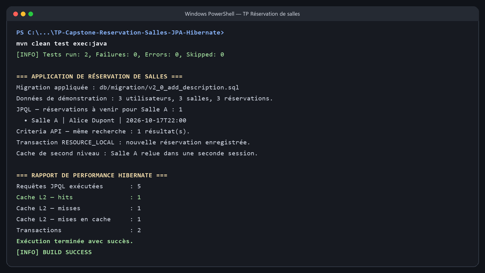

# TP (Capstone) : Finaliser l'application « Réservation de salles » avec JPA & Hibernate

Application console Java autonome qui assemble les étapes techniques du TP : modèle JPA, cache de second niveau Hibernate, jeu de données, tests, migration SQL via JDBC, requêtes JPQL et Criteria API, transactions, gestion de conflits et rapport de performance.

Le projet suit la contrainte pédagogique « JEE pur » : il n'utilise pas Spring. Il fonctionne avec Hibernate 5.6, JPA 2.2 et une base H2 en mémoire afin de pouvoir être lancé sans installer ou configurer un serveur SQL.

## Fonctionnalités réalisées

- Entités Utilisateur, Salle et Reservation, contraintes de colonnes, relations ManyToOne en chargement paresseux et verrouillage optimiste avec @Version.
- Cache de second niveau Hibernate/Ehcache pour Salle et collecte des statistiques Hibernate.
- Initialisation d'un jeu de démonstration avec trois utilisateurs, trois salles et des réservations datées dynamiquement.
- Service de réservation transactionnel avec contrôle de période et détection des chevauchements.
- Recherches paramétrées en JPQL et Criteria API.
- Migration versionnée SQL exécutée par JDBC au démarrage. Le script H2 est réexécutable sans recréer la colonne ou l'index.
- Scénarios JUnit 5 pour la création d'une réservation et le refus d'un chevauchement.
- Logs Java standard et fermeture contrôlée des ressources.

## Prérequis

- JDK 11 ou supérieur
- Maven 3.8 ou supérieur
- Connexion Internet au premier lancement pour récupérer les dépendances Maven

## Exécution dans le terminal

Depuis le dossier du projet :

<pre>mvn clean test exec:java</pre>

L'application crée son schéma H2 en mémoire, applique la migration, insère les données, affiche les résultats JPQL/Criteria, enregistre une réservation et imprime les statistiques Hibernate. Les données sont réinitialisées à chaque exécution.

### Capture de l'exécution

La capture de sortie ci-dessous présente le résultat du TP dans le terminal, sans capture de code.

## Scénarios automatisés

Pour exécuter les scénarios JUnit :

<pre>mvn test</pre>

## Structure du projet

<pre>
src/main/java/com/example/
├── MainApp.java
├── model/                 # Entités JPA
├── service/               # Réservation et règles métier
└── util/                  # Migration, données, requêtes et statistiques
src/main/resources/
├── META-INF/persistence.xml
└── db/migration/          # Scripts SQL de migration
src/test/java/             # Scénarios JUnit 5
docs/images/               # Capture de l'exécution
</pre>

## Remarques techniques

- Le script fourni cible H2 (ADD COLUMN IF NOT EXISTS et CREATE INDEX IF NOT EXISTS). Pour MySQL ou PostgreSQL, adaptez cette syntaxe au dialecte concerné.
- L'exemple est une application pédagogique locale : H2 en mémoire et le pool JDBC intégré à Hibernate conviennent à la démonstration, pas à une mise en production.
